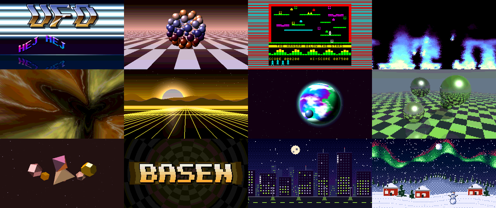

# ufoscene.net — a hymn to the Swedish demo scene

**Live at <https://ufoscene.net>** · share it, and your party photos, with **#ufoscene**

**Help Ukraine 🇺🇦** at <https://ukraine.ufoscene.net> (also <https://pi.ufoscene.net>): donate
to the defence of Ukraine and get a Raspberry Pi running ufoscene. The **Help Ukraine** link in
the panel (**P**) goes there.

**UFO: 100 Amiga-style demos that dance to your music**, written in Rust and running in the browser.
Copper bars, chrome logos, sine scrollers, glenz vectors, plasma, tunnels, a ZX Spectrum-style
platform room and a snowy Swedish village: every part reacts to the bass, the beat and the
treble of whatever is playing. Cast it to the TV and put on a playlist.



- **74 effects, 100 demos.** Demo 1 is the original UFO demo; demos 2–100 are generated from the
  effect library, each with its own title, (made-up) group, palettes, parts, transitions and
  scroll text.
- **Real-time and retro.** Rust renders every pixel into a 384×216 framebuffer, reduced to
  12-bit Amiga colour, compiled to WebAssembly without any crates. A little JavaScript feeds
  it audio and puts the frames on a canvas.
- **Music from anywhere.** Share the sound of a browser tab, use a loopback device such as
  BlackHole on a Mac, or just the microphone. With no sound it runs on a 125 BPM autopilot.
- **Optional Spotify connection:** a new demo for every song, the artist and song in dancing
  letters, photos of the artist (Spotify and Wikimedia Commons) worked into the graphics,
  playlists made from a text file, and Space to skip a song.

## A hymn to the Swedish demo scene

In the 80s and 90s, teenagers all over Sweden carried their Commodore 64s and Amigas, and a
monitor or a heavy CRT TV, into school halls, community centres and basements. They stayed up
all weekend to show what the machines could do. They formed groups with names that sounded
dangerous, swapped disks by post, and met at demo parties to compete in the *compos*. A
*demo* was the result: a few minutes of real-time graphics and music, squeezed out of hardware
that was never meant to do it, with greetings to friends and rivals in the scroll text.

UFO is a love letter to that time. Every effect here is a technique the scene invented or
perfected:
- **copper bars and raster tricks**, from changing the colours line by line as the beam swept
  down the screen
- **glenz vectors and vector balls**, real-time 3D before 3D cards existed
- **plasma, tunnels and rotozoomers**, cheap tricks with lookup tables that look like magic
- **sine scrollers and chrome logos**, the signature of every group

The screen is reduced to the Amiga's 4096 colours and drawn with a home-made pixel font, Å, Ä
and Ö included. The demo titles, groups and scroll texts are made up, but they are written in
the spirit of the real ones, in Swedish and English.

The scene shaped more than demos. It trained a generation of programmers, graphic artists and
musicians, several Swedish game studios were started by former demosceners, and parties that
began in the 90s grew into some of the biggest computer festivals in the world. The demo scene
has since been recognised as living cultural heritage in several European countries.

A few of the people and places that came out of it:
- **DICE**, the Swedish studio behind *Battlefield*, was started in Växjö by members of the
  Amiga group The Silents.
- **DreamHack** began as a small party in Malung and grew into one of the world's biggest
  computer festivals.
- **Jesper Kyd**, also of The Silents, went on to compose the music for *Hitman* and
  *Assassin's Creed*.
- **Future Crew** from Finland made *Second Reality*. Its members went on to found **Remedy**
  (*Max Payne*, *Alan Wake*) and **Futuremark** (3DMark); its musicians Purple Motion and
  Skaven write music for orchestras and games.
- **Housemarque** (*Resogun*, *Returnal*) was founded by Finnish demosceners, and **Bjørn Lynne**
  went from Amiga music to game soundtracks like *Worms*.

The scroll texts now and then slip in one of these as a *did you know?*.

### The music

In the scene, the music mattered as much as the graphics. Musicians wrote *tracker* songs: four
channels of samples on the Amiga, three voices of the SID chip on the C64, and somehow made
them sound like a whole band. A good demo moved *with* its music: every flash, cut and bounce
landed on the beat.

UFO turns that around. It does not come with its own soundtrack; it listens to yours. Swedish
pop from the 80s, synth classics, 90s eurodance, chiptune or today's hits: UFO hears the bass,
the beat and the treble, finds the tempo, and lets bars, balls, letters and pixels dance to
it. The built-in [playlist](web/playlist.txt) starts with Swedish 80s and 90s pop, synth
classics and 90s dance, if you need a place to start.

## Made for parties

UFO is at its best on a big screen with the music turned up: a house party, a LAN party, a
retro night, a release party, an office party or a bar.

- **Hours without repeats.** 100 demos of a couple of minutes each. With Spotify connected,
  every new song brings a new demo, so the screen changes when the music does, and a playlist
  started from the page shuffles forever.
- **Everybody's songs on the screen.** The artist and song name dance in at every new song,
  and photos of the artist turn up in the effects.
- **A party playlist in a minute.** Let the guests write their wishes into a text file, one
  `Artist - Title` per line, and UFO turns it into a Spotify playlist.
- **Easy to pass on.** Press **Q** and a QR code to ufoscene.net fills the screen for ten
  seconds, with **#ufoscene** dancing underneath and a line asking the guests to post their
  party photos with **#ufoscene**. Now and then the share band at the top asks for them too.
- **One key for the DJ.** **Space** skips to the next song, **B** goes back, **R** jumps to a
  random demo, and **J** switches to shuffle.
- **Runs all night.** Fullscreen with **F**, the mouse pointer hides, and **TV mode** (**T**)
  keeps Cast tab smooth on a TV. With HDMI or a projector it is smoother still. If the music
  stops, a 125 BPM autopilot keeps the screen alive until it starts again.

## Quick start

You need [Rust](https://rustup.rs) and Chrome (or another Chromium browser). macOS and Linux
are tested; Windows should work from Git Bash or WSL.

```bash
git clone https://github.com/ulfmansson/ufoscene.git
```

```bash
cd ufoscene && ./run.sh
```

`run.sh` installs the `wasm32-unknown-unknown` target if needed, builds `web/ufo.wasm` and
serves `web/` on <http://127.0.0.1:8100/>. Open that: on the first visit a short **setup
guide** asks where the music comes from and whether you want song names and artist photos.
**Just play** starts 80s and 90s radio straight away, with nothing to set up. The guide comes
back with **G**.

**Step-by-step guides** for every setup (the browser, Mac, Windows, Linux and ChromeOS, phones,
the TV, a Raspberry Pi party box, running from the source and hosting your own copy) are at
<https://ufoscene.net/guides.html>, in [`web/guides.html`](web/guides.html), and linked from the
panel (**P**) and the setup guide.

## Where the music comes from

| Source | How | Notes |
|--------|-----|-------|
| **Internet radio** (no setup at all) | Press **Play radio**, or **Just play** in the guide | Pick a decade (70s, 80s, 90s, 00s, 10s) and a genre (synthpop & new wave, Italo disco, Eurodance, disco, synthwave, trance, house, classic rock, hip hop, chiptune & demoscene). Stations come from the community directory [radio-browser.info](https://www.radio-browser.info). Stations that send the song now playing (Heart, Smooth, Gold, Capital, Radio X) come first: then every song gets its artist and title in dancing letters, a new demo, artist photos and the cover. **Space** / **B** change station |
| **A browser tab** (no install) | Play music in another tab, e.g. the Spotify web player, then press **Start with audio from a tab** and pick that tab with *Also share tab audio* on | That tab goes quiet and UFO plays the music instead, so Cast tab takes it to the TV |
| **BlackHole** (macOS) | `brew install --cask blackhole-2ch`, set System Settings → Sound → Output to *BlackHole 2ch*, press **Start** and allow the microphone | Catches any app, including the Spotify desktop app. If BlackHole does not appear: `sudo killall coreaudiod` |
| **Microphone** | Press **Start** without BlackHole installed | Hears the room; fine for music from a speaker |

**Play the music on** (in the panel) chooses where UFO plays what it hears: *this tab* (for
Cast tab), a device such as your speakers or an HDMI/AirPlay TV, or *nowhere*. It never plays
back into BlackHole, which would loop the sound.

## On the TV

- **Cast tab**: Chrome ⋮ → *Cast, save and share → Cast…* → *Sources* → **Cast tab**.
  Turn on **TV mode** (**T**): a steady 30 fps without the scanline overlay, which Cast's video
  encoder carries far more smoothly.
- **HDMI or AirPlay screen mirroring** are smoother still. Pick the TV under *Play the music on*.

## Keys

| Key | |
|-----|-|
| **Space** | start; while running: next song in Spotify or next radio station (**B** previous) |
| **← →** | previous / next demo |
| **N** | next part |
| **R** | random demo |
| **J** | after a demo: play the next, repeat it, or shuffle |
| **T** | TV mode |
| **H** | info overlay (demo, part, palette, BPM, levels) |
| **Q** | a QR code to <https://ufoscene.net> with #ufoscene, for 10 seconds, so guests can open it on their phones |
| **C** | the 30-minute pixel concert (below); **C** again ends it |
| **U** | Ukraine at Eurovision, a 10-minute pixel show (below); **U** again ends it |
| **K** | Kite at Dalhalla, 87 minutes, as long as the record (below); **K** again ends it |
| **F** | fullscreen (or double-click; double-tap on a phone) |
| **P** / **Esc** | pause everything (demo, radio, Spotify) and show the settings panel; **P** again carries on |
| **G** | setup guide |

On a phone or tablet there are no keys: tap the running demo to pause it and open the settings,
and **Start** carries on.

`http://127.0.0.1:8100/#42` opens demo 42. Each show has an address of its own that goes
straight into it, no Start needed: `/queen` (or `/concert`), `/ukraine` and `/kite`, such as
<https://ufoscene.net/kite>; `#queen`, `#ukraine` and `#kite` do the same.

## The 30-minute concert

Press **C** (or **🎸 Concert** in the panel, or open <https://ufoscene.net/queen>) for half an hour of live concert on a pixel stage: a four-piece band under a lighting
truss, an LED wall, speaker stacks and a crowd that jumps, claps and holds up lighters to the
music. A show clock counts to 30:00, then the demos carry on.

The show runs in acts: the doors open in the dark, then a clap-along, a light show, pyro, a
disco with a mirror ball, a stadium wave, a guitar solo, a piano ballad and a finale with
fireworks and confetti, before the band takes a bow. With song names (Spotify, Last.fm or the
radio) every new song starts the next act, and the artist's photo shows on the LED wall;
without them the acts change every few minutes. **N** skips to the next act.

With Spotify connected (Premium), the concert starts its setlist on your Spotify app, in order:
[`web/playlists/concert.txt`](web/playlists/concert.txt), Queen's greatest hits in about 29
minutes. Swap in any band: one `Artist - Title` per line, and keep it just under 30 minutes so
the last song ends before the bow. The music reaches UFO the usual way (a tab, BlackHole or the
microphone), so the band plays along. The band on stage is made up; it plays whatever is on.

### Ukraine at Eurovision

Press **U** (or **💙💛 Ukraine at Eurovision**, or <https://ufoscene.net/ukraine>) for ten minutes of Ukraine's
three Eurovision winners on the same stage, one act each, staged after their Eurovision
performances:

- **Wild Dances** (Ruslana, 2004): fire, big frame drums, trembita horns and a red ornament on
  the LED wall
- **1944** (Jamala, 2016): the stage goes dark and a tree grows out of it behind the singer,
  across the whole back wall, while the crowd holds up lighters
- **Stefania** (Kalush Orchestra, 2022): embroidery on the LED wall, a flute, a breakdancer
  and a pink bucket hat
- **The finale**: the flag waving on the LED wall, *12 POINTS*, sunflowers along the stage,
  blue and yellow fireworks and confetti, and *DYAKUYU!* ("thank you") at the bow

During each of the three acts, the artist and song are shown left of the LED wall, and the
result right of it: *1ST PLACE*, Eurovision, the year and the points (280, 534 and 631).

With Spotify connected, **U** plays [`web/playlists/ukraine.txt`](web/playlists/ukraine.txt)
in order. The performers are the same made-up pixel band; only the staging nods to the
originals.

### Kite at Dalhalla

Press **K** (or **🪁 Kite at Dalhalla**, or <https://ufoscene.net/kite>) for a show inspired by
the Swedish synth duo Kite's homecoming concert in the Dalhalla quarry near Rättvik on
2 September 2023, exactly as long as the record of that night, *Live At Dalhalla* (2026):
1:27:10, 17 songs. It has a stage of its own: pale limestone walls with pines along the rim, a
lake between the stage and the terraces that mirrors the lights, and the September sky going
from dusk to stars during the show. A singer with a microphone in hand and a synth player
behind a rig of keyboards are on stage.

Each song is an act of its own, named in the corner as it starts: white beams fanning up into
the evening for *Remember Me*, lasers over the water, the quarry walls flooded in colour,
searchlights into the night, strobes, a lone spot and phone lights for *Don't Take The Light
Away*, an empty stage and wandering lights for the two songs played from tape, eight red
signal flares burning on the rock face for *Glassy Eyes* (as on the night), and fireworks over
the rim for *Nocturne*. At the end the duo comes to the front: *TACK DALHALLA!*

With Spotify connected, **K** plays the album *Live At Dalhalla* itself, in order (the setlist
[`web/playlists/kite-dalhalla.txt`](web/playlists/kite-dalhalla.txt) names it with
`# album:`, and falls back to its songs one by one). Every new song starts the next act;
without song names the acts follow the record's own track lengths, so starting the record and
the show together keeps them in step.

## Easter eggs

There are a few. No spoilers, only hints:

- A cheat code that every gamer from the 80s knows by heart, typed while a demo runs.
- A word of three letters. You can guess which.
- The calendar and the clock: some days and some nights are special, in a Swedish way.
- The browser console has something to say to sceners.
- And sometimes something just flies by on its own.
- A secret show that no key opens. Donate at least 500 kr to the defence of Ukraine on
  [pi.ufoscene.net/concert](https://pi.ufoscene.net/concert) and you get the link. With 5000 kr
  it plays for everyone on ufoscene.net at a time you pick, with your dedication on the stage
  (`web/concerts.js`).

Not a secret: from 23 to 28 December the show opens with a Swedish Christmas night, a red
cottage with candles in the windows, a straw goat and a tree that blinks to the music, before
the demos start. (Can't wait? `ufo.christmas()` in the browser console shows it any day.)

Found one? Tell people with **#ufoscene**. Ideas for more are welcome (see
[CONTRIBUTING.md](CONTRIBUTING.md)).

## Song names with Last.fm (optional, works for anyone)

If you scrobble to [Last.fm](https://www.last.fm) (Spotify, Apple Music and most players can),
UFO can read what you are playing from your public Last.fm profile: the song name in dancing
letters, a new demo per song, and artist photos and covers. The setup guide (**G**) asks for your
Last.fm user name and a free API key. Unlike the Spotify connection below, this works for
everyone, without Premium or a user list.

## Spotify (optional)

Spotify only provides song information and control here. The music itself reaches UFO through
one of the sources above.

1. At <https://developer.spotify.com/dashboard>, create an app. Redirect URI:
   `http://127.0.0.1:8100/callback` (Spotify accepts `127.0.0.1`, not `localhost`); tick **Web API**.
2. Copy its **Client ID** (not the secret) into the panel's Spotify field and press **Connect**.

What it adds: every new song starts a new demo (unless you untick it), the artist and song
slide in as dancing letters, and a picture of the artist appears about every 45 seconds,
each credited in the corner. **Space** / **B** skip songs, and you can make playlists from text
files (next section).

Spotify's current rules, as of November 2026: the owner of a development-mode app needs
**Spotify Premium**, and only the owner plus **up to 5 users** added under *User Management*
can log in. Skipping songs and *Play it now* also need Premium. Port 8100 is fixed because the
redirect URI names it: if it is taken, use `PORT=8200 ./run.sh` and register that port's
redirect URI too.

## Ready-made playlists

[`web/playlists/`](web/playlists/) holds 17 song lists: decades from the 70s to the 00s, the 10
genres, Kite, and computer music from the 80s, 90s and later. Once they are published as public
Spotify playlists, the panel offers them to everyone: **Open in Spotify** works for anyone, and
**Play in Spotify** works for people who can connect.

A playlist started from the page (**Play in Spotify** or **Play it now**) plays forever: it
starts on a random song, shuffles, and starts over when it reaches the end. **Open in Spotify**
leaves shuffle and repeat to the Spotify app.

To publish them (the site owner, once), stop `./run.sh` and run:

```bash
node site/publish-playlists.mjs --client-id <your Spotify Client ID>
```

It prints a Spotify login link. Log in with the account that should own the playlists. The
script then makes every list without a link as a public playlist, writes the links into
`web/playlists/index.json` and lists the songs Spotify could not find. Commit that file and
deploy. Running it again only makes the lists that still have no link; `--dry-run` shows which
those are. It uses the same redirect URI as the page (`http://127.0.0.1:8100/callback`), so
nothing new needs registering; with `--port <n>`, register `http://127.0.0.1:<n>/callback` too.
The Client ID can also come from `SPOTIFY_CLIENT_ID` or `spotifyClientId` in `site/config.json`.

## Playlists from a text file

In the panel, choose a `.txt` file, or press **Use the built-in list** for
[`web/playlist.txt`](web/playlist.txt) (Swedish 80s/90s pop, synth classics, 90s dance). One song
per line:

```text
# name: Fredagsdemo
Europe - The Final Countdown
Roxette - Joyride
```

A line can also be a song link from Spotify (*Share → Copy song link*). UFO looks each song up,
creates a **private** playlist in your account, lists what it could not find, and offers
**Open in Spotify** and **Play it now**. Each run creates a new playlist.

## Develop

```bash
cd ufoscene && cargo test --release
```

The tests render every effect with several seeds, palettes and fake live audio (nothing may
panic, go black or take more than 6 ms per frame natively), check that all 100 demos differ and
that their texts only use characters the font has, and run the demo player through part and
demo changes.

```bash
cd ufoscene && cargo run -p ufo-demo --example fxsnap --release -- snapshots/fx
```

`fxsnap` writes one PNG per effect plus `sheet.png` with all of them (arguments: output folder,
name filter, seconds, seed). `--example snap --release -- 42` writes one PNG per part of demo 42.

### Adding an effect

An effect implements `fx::Effect` (`fn draw(&mut self, fb: &mut Fb, c: &Ctx)`) and is listed
with a `Def { name, flags, make }` in one of the `register` functions. `Ctx` gives the time,
the music (`a.bass`, `a.mid`, `a.treble`, `a.beat`, `a.pulse`, `a.bins`), the demo's `pal`ette,
the beat count and the artist picture. `make(seed)` should use the seed to pick a variant, so
the effect looks different in different demos. See the top of `demo/src/fx/mod.rs`.

| Path | What |
|------|------|
| `demo/src/fx/mod.rs` | effect API, 16 palettes, shared helpers (3D maths, lines, dancing letters), the effect test |
| `demo/src/fx/classic.rs` | the original seven: copper bars, glenz, vector balls, twister, tunnel, Kefrens bars, Spectrum room |
| `demo/src/fx/pixel.rs` | plasma, fire, metaballs, moiré, ripples, Julia, Mandelbrot, kaleidoscope, hypno, life, glyph rain, Voronoi, lava |
| `demo/src/fx/deform.rs` | rotozoom, flower and square tunnels, swirl, planes, mode 7, voxel landscape, bump mapping, lens, outrun, planet, flag, Droste |
| `demo/src/fx/vector.rs` | starfield, dot morph, torus, wireframes, rubber cube, cube field, dot tunnel, bob trails, ray tracer, EQ city, fountain, Lissajous, gems |
| `demo/src/fx/oldskool.rs` | raster bars, shadebobs, sine dots, parallax, checker wave, radial EQ, analyser, text zoom, dot logo, vertical bars, crawl, night city, snowfall |
| `demo/src/fx/zxgames.rs` | original ZX Spectrum-style game scenes: isometric room, ladders, maze raid, space shooter, tape loader, text adventure, road racer, desert front (a campaign map with unit counters and supply lines), compass view (a lord's first-person view turning through the compass points) |
| `demo/src/fx/abcgames.rs` | an original ABC 80-style game scene: a moon lander on an emulated Luxor ABC 80 screen (40×24 teletext characters, 78×72 mosaic dots, START/SLUT GRAFIK, the Swedish character set) |
| `demo/src/fx/image.rs` | the artist picture: dithered portrait, flag, tunnel, rotozoom, halftone |
| `demo/src/demo.rs` | the demo player: parts, title card, logo, scroller, now playing, transitions, HUD |
| `demo/src/recipes.rs` | the 100 demos: titles, groups, palettes, parts, scroll texts |
| `demo/src/audio.rs` | FFT bins → bass/mid/treble, beats, tempo, autopilot |
| `demo/src/gfx.rs`, `font.rs`, `zx.rs` | framebuffer and primitives, the 5×7 font with ÅÄÖ, the Spectrum room |
| `demo/src/lib.rs` | the C ABI that `ufo.wasm` exports to the page |
| `serve/` | std-only static file server on 127.0.0.1 and ::1 |
| `native/` | `ufo-native`, the demos on a Raspberry Pi with no browser: DRM/KMS to the TV, PipeWire sound, the phone remote (std only, experimental): see [`native/README.md`](native/README.md) |
| `web/` | `index.html`, `ufo.js` (glue, audio, keys), `guide.js` (setup guide), `guides.html` (step-by-step guides per environment), `radio.js` (internet radio), `eggs.js` (when the easter eggs come; they are drawn in `demo/src/eggs.rs`), `concerts.js` (the secret show's link and the public concerts booked on pi.ufoscene.net), `spotify.js`, `lastfm.js`, `pictures.js` (Wikidata/Commons photos), `playlist.txt` |
| `site/` | building and hosting it as a public website (AWS S3 + CloudFront with Pulumi, or Cloudflare): see [`site/README.md`](site/README.md) |

## Contributing

Ideas are very welcome: new effects, features, songs, radio stations, scroll text lines, bug
reports and party reports. Please open an [issue](https://github.com/ulfmansson/ufoscene/issues/new/choose).
Code contributions (pull requests) are not accepted; see [CONTRIBUTING.md](CONTRIBUTING.md).

## Credits and notes

- All graphics, sprites, scenes, the font, demo names, group names and texts are original. The
  effects are classic demoscene *techniques*; no existing demo, game or logo is recreated.
- Artist photos come from Spotify and from [Wikimedia Commons](https://commons.wikimedia.org);
  each is shown with its source, and Commons photos with their author and licence.
- Not affiliated with or endorsed by Spotify. Spotify is a trademark of Spotify AB.
- Licence: [MIT](LICENSE).
